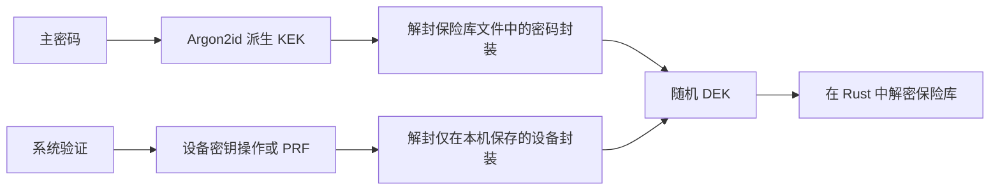

# 数据密钥与系统解锁方案评估

调查日期：2026-10-26。范围是当前 KVault 代码、Apple/Microsoft/W3C 文档，以及指定版本的插件源码。本次不改变保险库格式、不读取实际秘密、不创建系统授权，也没有进行新的原生认证验收。

实施补记（2026-10-26）：后续已按产品决定实现 Windows 原生 WebAuthn PRF + AES-256-GCM，要求 API ≥ 8，并移除 CNG 兼容实现。下文保留替换前的方案评估；当前实现以 [存储说明](storage-security.md#windows) 为准。没有引入 `tauri-plugin-biometry`，也没有调整 macOS 加密路径。

## 结论

保留当前“随机数据密钥 + 主密码封装 + 可选本机系统封装”的架构。系统解锁释放数据密钥，不保存或恢复主密码。macOS 可以继续使用现有 CryptoKit Secure Enclave 适配；Windows 优先评估原生 WebAuthn PRF，现有 Passport CNG 作为需要实机验证的兼容实现。`tauri-plugin-biometry` 有可用的构件，但在不采用 Developer ID/provisioning 的 macOS 发布条件下，不宜直接替换全部原生适配。

## 三种不同的秘密

| 名称 | 用途 | 持久化方式 |
| --- | --- | --- |
| 主密码 | 用户输入的恢复与解锁依据 | 不保存；输入与调用结束后清理 |
| KEK，密码派生密钥 | Argon2id 派生，用于解封数据密钥 | 不保存，仅在相关操作中临时存在 |
| DEK，随机 256 位数据密钥 | 对业务数据执行 AEAD 加解密 | 密码保护的封装进入保险库文件；设备保护的封装仅留本机 |

当前 `vault/crypto.rs` 已实现上述区分：`Keys::new` 随机生成 DEK，`derive_kek` 从密码派生 KEK，`Header.wrapped_key` 保存 DEK 的密码封装。`Keys::derive` 用密码恢复 DEK；`Keys::from_device` 接受系统解锁路径恢复的 DEK。前端 Snapshot 不包含 KEK 或 DEK。

两条解锁路径是可选其一，不是“必须主密码加指纹”的双重验证。设备封装丢失、系统重装或更换电脑后，仍可以主密码解锁并重新启用系统解锁。设备封装和其恢复元数据不应随云端快照同步。

## 启用和恢复流程

1. 用户在安全设置主动启用，并验证当前主密码；Rust 此时已持有正确 DEK。
2. 原生适配创建受用户验证约束的设备密钥，或注册支持 PRF 的平台凭据。
3. 使用设备保护机制封装 DEK，保存带版本、提供程序、保险库身份和密钥代次绑定的本机封装。
4. 完成一次实际恢复和保险库 AEAD 验证，全部成功后才保存启用标记。
5. 后续解锁从本机取出封装，由系统原生密码学操作请求验证，恢复 DEK 后直接在 Rust 中解密。命令只返回业务 Snapshot，不将 DEK 传给 React。

若使用插件的字符串型存取 API，需要在 Rust 内完成编码、读取和解码，不能让前端 `getData()` 得到数据密钥。常规加解密期间 DEK 需要存在于 Rust 进程内存；硬件保护不等于应用解锁后永不出现明文密钥。

## macOS：现有实现可继续保留

现有 `security/macos.swift` 使用 Secure Enclave P-256 私钥，设置 `.privateKeyUsage + .userPresence`；ECDH 与 HKDF-SHA256 产生封装密钥，ChaChaPoly 封装 DEK。login Keychain 保存的是 Secure Enclave 的不透明密钥表示、临时公钥、盐和 DEK 密文。后续恢复必须实际执行受验证约束的私钥操作。

Apple 明确说明，CryptoKit Secure Enclave 密钥的 `dataRepresentation` 是仅同一 Secure Enclave 能恢复的加密块，不是可导出的私钥明文。将这个块与业务密钥的密文保存在外部存储，是有文档依据的机制；KVault 采用了该机制并自行组合封装协议。[Apple CryptoKit 存储说明](https://developer.apple.com/documentation/cryptokit/storing-cryptokit-keys-in-the-keychain)

Data Protection Keychain 则提供条目存储、访问组和应用身份管理。Apple TN3137 要求相关 entitlements 由 provisioning profile 授权；换成自己写的 Tauri 插件或 Swift 桥接不会消除这项要求。现有实现没有将 DEK 保存成 Data Protection Keychain 受验证条目。[Apple TN3137](https://developer.apple.com/documentation/technotes/tn3137-on-mac-keychains)

这里“不使用签名”应理解为“不购买并采用 Developer ID 正式签名、公证”。Apple silicon 上原生 arm64 代码仍需至少 ad-hoc 签名；ad-hoc 不提供 Apple 验证的发布者身份，也不能代替受限权限的授权。[Apple 平台安全说明](https://support.apple.com/en-gb/guide/security/secebb113be1/web)

现有 `.userPresence` 允许生物识别或系统允许的密码验证，新增指纹不会自动令授权失效。若以后提供“仅当前已登记生物识别”策略，应评估 `.biometryCurrentSet`，并明确重新录入指纹后需要主密码恢复。本次用户要求的系统级验证仍适合保留密码/PIN 回退。[Apple userPresence](https://developer.apple.com/documentation/security/secaccesscontrolcreateflags/userpresence)

## Windows：建议评估 WebAuthn PRF

当前实现通过 Passport KSP 创建 RSA 密钥、OAEP/SHA256 封装 DEK，并设置 `NgcCacheType` 和 `PinCacheIsGestureRequired`。这种设计要求系统验证约束真正作用于私钥使用，比“先显示验证弹窗，再由普通进程读取密钥”更符合需求，但涉及 Passport 扩展属性和提供程序兼容性。现有报错仍需用户设备的阶段和状态码定位，不能以本次调查认定根因。

新的候选路径：通过原生 Win32 WebAuthn 注册平台凭据，要求用户验证，利用 PRF/hmac-secret 得到稳定的 32 字节秘密，再用其作为封装密钥，或通过带 KVault 上下文的 HKDF 派生封装密钥，以 AEAD 封装 DEK。凭据 ID、公开 PRF 输入、nonce 和密文可留本机；PRF 输出不能保存。W3C 规范定义了这种用于数据加密的扩展。[W3C PRF 说明](https://github.com/w3c/webauthn/blob/main/explainers/prf-extension.md)、[Microsoft 原生 WebAuthn API](https://learn.microsoft.com/en-us/windows/win32/api/webauthn/)

这条原生 Win32 调用路线没有 macOS Data Protection Keychain 的 Developer ID/provisioning 前置条件；但仍需检查 Windows API 和认证器是否真正返回 PRF 输出。Hello 已配置、弹窗成功或存在 WebAuthn API，都不足以证明 PRF 可用。要求每次用户验证，不支持时保留主密码，不静默切换到验证不绑定密钥的实现。若产品要求“本机设备绑定”，还需要明确平台认证器范围与可备份/可同步凭据的处理策略，不能将所有 passkey 等同于本机 Hello 密钥。

Microsoft WebAuthn 头文件中，注册参数 `bEnablePrf` 与注册时求值 `pPRFGlobalEval` 属于不同的结构版本。可以评估“先注册，再求值”的流程，避免仅为减少一次提示而机械要求插件的注册时求值接口版本；是否能扩大兼容范围仍需实机验证。[Microsoft webauthn.h](https://github.com/microsoft/webauthn/blob/master/webauthn.h)

现有 `availability()` 主要检查能否打开 Passport 提供程序，建议拆分“系统验证存在”“密钥提供程序支持”“封装机制已实测”三个状态。Windows Hello 可以采用 TPM 或软件保护，不能仅凭 Hello 可用就承诺硬件绑定。[Microsoft Windows Hello](https://learn.microsoft.com/en-us/windows/apps/develop/security/windows-hello)

普通 DPAPI 默认面向同一账户与设备。把 DEK 交给普通 DPAPI，然后仅在应用逻辑中先调用 `UserConsentVerifier`，不能证明绕过该应用逻辑的同账户进程也必须完成新的 Hello 验证。不要把这种便利解锁包装成密码学层面的每次认证约束。[Microsoft DPAPI 范围说明](https://learn.microsoft.com/en-us/windows/win32/seccrypto/example-c-program-using-cryptprotectdata)

## tauri-plugin-biometry 的适用范围

本次分别检查可下载的 `0.2.8` 发布包与主分支提交 `820a6eccdd9bd6c58c4620903f5e07975b42ed61`。后者 `Cargo.toml` 标记为 `0.3.0-rc.3`；不能将主分支源码当成 0.2.8 的行为，也不以缓存中的 `latest` 页面确定当前发布状态。

| 范围 | 查到的机制 | 对 KVault 的判断 |
| --- | --- | --- |
| macOS 的 `authenticate` | LocalAuthentication 验证结果 | 可用于验证 UI，但单独调用不能释放不存在的 DEK |
| macOS 的安全存储 | Data Protection Keychain + `SecAccessControl(userPresence)` | 有签名/权限配置时可用；无法绕过当前的无正式签名约束 |
| Windows 0.2.8 | KeyCredential 签名结果经 SHA256 派生 AES-CBC 密钥，IV 来自 domain，密文进入 PasswordVault | 需要单独审查其密钥生命周期、完整性保护和多记录行为；不建议作为本次重构的直接替换 |
| Windows 上述主分支 | 平台 WebAuthn PRF + AES-256-GCM；要求 API ≥ 8 | 机制值得参考，但仍需审查具体版本和 PRF 支持，不能视为所有 Hello 设备均可用 |

0.2.8 的固定 IV 来源和 CBC 使用是源码观察，不是已经完成的漏洞利用或完整安全审计结论。当前主分支已经采用不同协议，不能将这些观察归到其新实现。新实现明确使用注册时 PRF 求值减少提示，这是其 API 版本门槛的重要背景。

源码依据：[0.2.8 Windows 发布源码](https://docs.rs/crate/tauri-plugin-biometry/0.2.8/source/src/windows.rs)、[固定提交 macOS 实现](https://github.com/Choochmeque/tauri-plugin-biometry/blob/820a6eccdd9bd6c58c4620903f5e07975b42ed61/src/macos.rs)、[固定提交 Windows 实现](https://github.com/Choochmeque/tauri-plugin-biometry/blob/820a6eccdd9bd6c58c4620903f5e07975b42ed61/src/windows.rs)、[固定提交版本号](https://github.com/Choochmeque/tauri-plugin-biometry/blob/820a6eccdd9bd6c58c4620903f5e07975b42ed61/Cargo.toml)。

## 建议的实现顺序

1. 保留现有随机 DEK 与主密码封装，系统解锁继续默认关闭。无需为更换设备适配修改云端数据格式。
2. 将本机封装抽象为带版本与提供程序标识的 `DeviceUnlock` 适配，统一启用、恢复、撤销和错误信息。只在 Rust 使用秘密字节；Swift/Windows 负责受系统约束的密码学操作。
3. macOS 沿用 CryptoKit 适配，补齐发布版升级、钥匙串访问提示与生物识别变更的验收，保持主密码恢复路径。
4. Windows 使用独立测试保险库验证 PRF 注册、重复恢复、重启、取消、PIN 重置和清除凭据；确认目标 Windows 版本后，再选择 PRF 主实现与经过验证的 CNG 兼容实现。无支持设备仍使用主密码。
5. 减少 `Keys` 克隆，尤其避免在整个网络等待期间持有 DEK 副本；沿用 `Zeroizing`、任务取消和会话代次检查。清零释放不能等同于保证操作系统、Swift 运行时或所有临时副本从未留下内存痕迹。
6. 启用系统解锁只影响本机。换密、导入替换、清除授权时撤销对应设备封装；跨设备更换密钥仍依靠主密码恢复与现有代次检查。

上述建议是代码与资料评估，不是安全审计认证。可以自行封装系统 API，但不能通过封装规避 OS 权限，也不能把“验证成功”的布尔值本身当成解密密钥。
