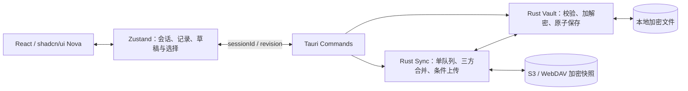

# KVault 技术报告

[返回项目首页](../README.md) · [使用指南](user-guide.md) · [开发指南](development.md)

本文描述当前 **0.3.0** 的实现与验证边界，作为维护和排查问题的参考。开发命令与平台依赖单独收录在开发指南中。

macOS Actions 产物的红绿灯偏移原因、动态修复实现、SDK 对照数据与原生复现程序见 [macOS 标题栏调查](macos-titlebar-investigation.md)。

## 架构与职责

前端负责交互与解锁后的业务展示；Rust 负责数据校验、密钥、持久化和网络操作。前端不直接访问文件系统或云存储。

| 模块                                   | 职责                                                     |
| -------------------------------------- | -------------------------------------------------------- |
| [vault](../src-tauri/src/vault/)       | 保险库生命周期、数据模型、加密、原子保存、导入与批量变更 |
| [sync](../src-tauri/src/sync/)         | S3 / WebDAV 适配、ETag 条件请求、三方合并、队列与重试    |
| [commands](../src-tauri/src/commands/) | IPC 参数校验、会话检查、文件选择、剪贴板与事件通知       |
| [stores](../src/stores/)               | 会话与修订号保护、记录草稿、勾选、临时排序与同步展示     |

## 数据模型与编辑提交

- 表与记录使用稳定 UUID；记录包含表 ID、Key、Value、备注、时间戳、删除标记与自定义排序。
- Key 必填，在同表内区分大小写且唯一；不同表允许相同 Key。表名称同样需要唯一。
- 删除保留墓碑，首版不自动清理。展示快照过滤已删除实体，同步文档保留墓碑。
- 记录编辑和排序采用显式保存。批量导入、移动、删除、排序先在状态副本上校验，再一次性加密落盘；校验失败不提交部分结果。
- 数据提交增加本地修订号，并在本地保存完成后安排同步。具体交互规则见[使用指南](user-guide.md)。

自动锁定策略保存在本机明文 `config.json`，默认开启、闲置 5 分钟，可关闭或设置为 1–1440 分钟的整数。该设置不进入加密业务载荷、云端快照或导出备份；修改策略不重写业务文件，不安排云同步。导入备份保留本机策略。

后端同时检查单调时钟与墙上时钟，覆盖系统休眠期间的闲置时间。后台任务在实际锁定时重新检查当前策略与最近活动，避免刚关闭自动锁定或重新操作后仍被过期检查结果锁定。保存策略后重新开始计时，关闭自动锁定不影响手动锁定或退出时清理会话。

## 本地持久化与备份

保险库位于 Tauri 的应用数据目录下，标识为 `com.taurusxin.kvault`：

- macOS：`~/Library/Application Support/com.taurusxin.kvault/`
- Windows：`%APPDATA%\com.taurusxin.kvault\`
- Linux：`$XDG_DATA_HOME/com.taurusxin.kvault/`，默认 `~/.local/share/com.taurusxin.kvault/`

`vault.kvault` 保存当前状态，`vault.previous.kvault` 是上一次写入前的完整加密本地文件。写入使用同目录临时文件、刷盘与原子替换，Unix 文件权限为 `0600`，并由单实例机制防止多个进程同时写入。恢复上一版本时，退出应用并保留当前文件，再将 previous 文件复制为 `vault.kvault`；该文件可能使用较早的主密码。

新保险库使用 **v2 二进制格式**：随机数据密钥加密 CBOR 业务载荷，Argon2id 从主密码派生封装密钥，再封装数据密钥。配置与凭据按敏感程度分别保存；完整字节布局、密钥层级、系统验证及异常处理见 [存储与系统解锁](storage-security.md)。不实现 v1 数据迁移或旧版加密备份兼容。

会话密钥仅在 Rust 内存中保存并使用 `Zeroizing` 清零；前端解锁后持有展示所需的明文，锁定时卸载编辑界面并清空 Zustand 状态。JavaScript 运行时与操作系统不保证所有历史内存副本、交换文件或系统剪贴板都被安全擦除。

记录的 `sortOrder` 字段保存自定义顺序。新记录与新导入的记录追加到自定义顺序末尾。单表排序只交换该表记录在整体顺序中的位置，保留其他表的相对次序；排序不改变 Key、Value、备注及内容更新时间。顺序随加密快照同步，同一记录的排序与其他设备编辑并发时遵循已有冲突处理规则。

设置中的导出、导入使用 `.kvault` 加密快照。导入会替换本地数据并清除同步配置，替换前需要确认并建议先导出当前保险库。主密码无法找回；历史备份始终需要生成时的密码。首版不包含附件或常规明文导出；系统解锁为默认关闭的本机可选功能。

## 加密格式与存储分层

实现见 [crypto.rs](../src-tauri/src/vault/crypto.rs)、[storage.rs](../src-tauri/src/vault/storage.rs) 与 [security](../src-tauri/src/security/)。

| 内容                                                         | 保存位置                                                     |
| ------------------------------------------------------------ | ------------------------------------------------------------ |
| 表、记录、排序、时间戳、墓碑、基线、冲突、恢复日志、凭据引用 | CBOR 编码后使用 XChaCha20-Poly1305 加密为二进制文件          |
| 主题、自动锁定、系统解锁引用                                 | `config.json`，无业务内容和密码                              |
| 云服务配置及全部凭据                                         | 本机 Keychain / Credential Manager / Secret Service          |
| 系统解锁密钥封装                                             | 独立的本机凭据条目；解封绑定 Secure Enclave 或 Windows Hello |

密码 KDF 为 Argon2id v19（64 MiB、3 次、并行度 1、随机 16 字节盐），DEK 为随机 256 位密钥。封装与每次载荷写入使用独立随机 nonce，文件头和用途参与认证。文件大小限制为 64 MiB，拒绝不受支持的格式与 KDF 参数。

`local` 载荷包含本地业务、同步基线、冲突与恢复信息，`snapshot` 只包含业务文档。云凭据和自动锁定字段在 `LocalState` 序列化时跳过。系统凭据服务不可用时仍可主密码解锁和本地编辑，云同步和换密暂停；不会回退为文件保存密码。完整规则见 [v2 格式说明](storage-security.md)。

## 云同步协议

每次只启用一个同步目标。S3 支持自定义 Endpoint、Region、Bucket、路径前缀、Path Style、Access Key / Secret Key 和可选 Session Token；WebDAV 支持地址、目录、用户名和密码。HTTPS 默认校验证书，HTTP 会在界面提示凭据传输风险，不支持自动跟随 WebDAV 重定向。

目标目录内固定对象名为 `vault.kvault`，内容为完整加密快照。连接测试会创建随机临时对象，检查读取、创建冲突、错误 ETag 拒绝、正确 ETag 写入及删除，并清理测试对象。凭据需要相应的读取、写入、删除权限，WebDAV 新目录还需要 MKCOL 权限。无法提供可靠 ETag 或条件写入的服务会被拒绝启用写同步。

解锁时同步，保存后等待 2 秒合并上传，解锁期间每 60 秒或重新获得焦点时检查，并支持手动同步。失败后从 15 秒开始指数退避，当前重试间隔最高 240 秒。锁定会取消正在等待的同步请求；离线保存不依赖云端。

同步按表与记录 UUID，对本地、最近成功同步基线、远端进行三方合并。独立修改自动合并；同一实体的双方修改、删除与编辑竞争、删表与子记录修改、重复 Key 或同名表都进入人工处理。冲突期间保留双方加密版本，暂停上传和常规编辑；可以采用一方或为另一方副本设置唯一名称后保留双方。删除墓碑首版不清理，防止离线旧设备恢复已删除内容。

上传使用 `If-None-Match: *` 创建，使用读取时的 ETag 执行 `If-Match` 更新，最多进行 3 轮重新拉取与合并。网络请求期间允许继续编辑，只确认实际上传的版本；新编辑继续保持待同步。不同保险库 UUID 拒绝连接或覆盖；已同步的云端文件被删除时，不会自动重新创建，需要重新配置目标明确初始化。

修改主密码时更换盐和密钥并重新加密。启用同步后需联网，先完成同步并解决冲突，再将新密钥状态暂存、将恢复日志写入旧本地文件，最后条件更新远端。若无法确认上传结果，进入只读恢复状态并保留新旧文件。重新联网解锁时，已提交的变更用新密码完成恢复，未提交的变更可用旧密码回滚；请勿手动删除 `password-change.pending`。其他设备先用其旧本地密码解锁，再在设置中输入新密码迁移，离线修改会参与合并。

### 后端与连接验证

- S3 使用 AWS SDK for Rust；WebDAV 使用 reqwest。
- 常规远端请求设置 30 秒超时；WebDAV 不自动跟随重定向。
- 条件能力测试写入的是临时探针文本，用于验证协议行为，不包含保险库业务数据。
- 单个同步任务队列串行处理网络同步；提交结果时比较本地修订号，保留请求期间的新编辑。

### 主密码变更与恢复

换密事务依赖旧本地文件、新密钥暂存文件和远端条件提交，不能将换密简化为直接替换本地密码。需要保留 `password-change.pending` 以判断远端是否已经提交，避免新旧密码下的状态被错误覆盖。

备份的密钥与生成时保持一致。其他设备的迁移也需要保留旧本地状态，并将离线修改带入新密钥下的合并流程。

## IPC 与会话隔离

- 生命周期：`bootstrap`、`create_vault`、`unlock_vault`、`lock_vault`、`touch_vault`。
- 数据：`mutate_vault` 接收表 CRUD、记录 CRUD/移动、`reorderEntries` 自定义排序、`moveEntries` / `deleteEntries` 原子批量操作、`importEntries` 批量导入、`setAutoLock` 本机自动锁定策略、同步设置及冲突解决动作；`copy_key`、`copy_value` 在 Rust 写入剪贴板。`select_import_csv` 打开原生 CSV 选择器，`preview_import` 解析并返回预览及行级错误。
- 云端：`test_connection`、`connect_remote`、`sync_now`。
- 安全：`set_system_unlock`、`unlock_with_system`、`change_password`、`migrate_password`、`export_backup`、`import_backup`；配置：`get_preferences`、`set_theme`。
- 事件：`vault:changed`、`vault:locked`、`sync:status`。错误统一为 `{ code, message }`，不回传服务密钥。

数据命令带 `sessionId`，锁定或会话切换后拒绝旧命令；前端也检查会话与修订号，忽略晚到的请求结果。渲染进程仅开放必要的窗口权限，文件选择和剪贴板由 Rust 操作；生产 CSP 限制到本地应用资源及 IPC。

主密码仅留在临时输入状态，提交后清空，不进入持久化 Zustand Store。Rust 会话密钥使用可清零的缓冲区；锁定时取消同步并清理后端会话，前端清空数据、勾选、草稿、临时排序和显隐状态。

锁定页的 `autoLockHint` 从启动时的本机配置及有效快照读取，不依赖解密。主密码入口始终存在；仅用户启用后显示系统解锁按钮。过期验证结果不能恢复已锁定的会话。

## 验证范围

验证命令、独立测试目录与样例数据见[开发指南](development.md#测试与验收)。

| 范围           | 测试覆盖                                                                                                        |
| -------------- | --------------------------------------------------------------------------------------------------------------- |
| 加密与持久化   | 往返加解密、错误密码、密文与头部篡改、随机 nonce、上一版本保存、写入失败时旧数据保留                            |
| 记录与批量操作 | Key 约束、级联墓碑、导入解析与重复策略、批量移动/删除原子性、排序持久化与旧数据兼容                             |
| 同步与合并     | 两种协议的条件写入、双设备独立修改、冲突保留、删除竞争、上传期间继续编辑、自定义排序同步                        |
| 密码变更       | 条件提交失败、上传结果不确定、暂存与恢复、重启恢复、其他设备新密码迁移与离线修改保留                            |
| 前端与会话     | 未保存提示、过期响应隔离、锁定清理、显隐与复制、导入预览、图标勾选、范围选择、排序保存/取消、设置入口与关闭提示 |

本地 HTTP 测试服务验证协议约束，不能代替特定 S3 厂商或 WebDAV 服务的兼容性验收。macOS 已进行本地构建与主要原生交互验证；Windows、Linux 仍需在相应环境构建和验收。测试覆盖不等同于独立安全审计。
